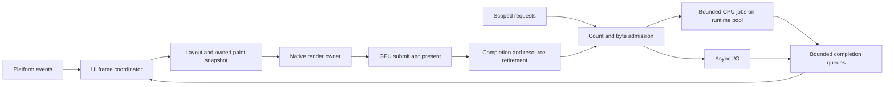

# Performance, stability, rendering, and scheduling roadmap

Status: proposed design, informed by code review and local measurements on 2026-10-12.
Scope: the retained UI framework, native rendering seam, background tasks, and the editor/game
workloads that share them. This document does not claim that the proposed scheduler exists.

**Recommendation:** first bound incoming work and resource ownership, then make frame deadlines
observable, then evaluate a render thread. Keep the .NET runtime responsible for executing tasks.
Zigote should control admission, result delivery, frame phases, and resource lifetime. The local
benchmarks do not justify replacing the thread pool, parallelizing layout, or rewriting the
reactive graph lock.

“Junk-free” here means both **jank-resistant** and **free of stale visual content and unbounded
resource accumulation**. It does not mean that an arbitrary application callback can be made
allocation-free or preempted safely. The contract must distinguish a reusable steady frame from
new content, task creation, cache growth, and native/GPU allocations.

## 1. Evidence and limits

The review started at managed commit `0457e3b` and native submodule commit `da5d756`, with existing
uncommitted edits in both repositories. Measurements use that working tree, not pristine commits.
Only benchmark and documentation files were changed for this investigation. The archived
[measurement report](../benchmarks/2026-10-12/README.md) records source fingerprints and raw samples.

New probes live in [Zigote.Runtime.Benchmark](../../Zigote.Runtime.Benchmark/README.md). They run
production methods, verify that work happened, and retain chronological samples rather than
selecting the fastest run. Three fresh processes were run sequentially for each mode.

| Test environment | Configuration |
|---|---|
| CPU / memory | Apple M3 Pro, 11 logical/physical cores reported, 18 GiB unified memory |
| OS / runtime | macOS 27.0 (26A428), .NET SDK 10.0.401, runtime 10.0.12, arm64 |
| Build | C# Release; native ReleaseFast, baseline CPU target; tiered compilation disabled for stable optimized-method measurements |
| Native graphics | M3 Pro integrated GPU, wgpu Metal, 120 Hz reported refresh, scale 2, requested 1200 × 900 window |
| Power / noise | OS reported AC power; battery also reported discharging. Power mode, thermal state, and other desktop processes were not controlled. |
| Instrumentation | Managed profiler off for headless; on for window runs. No GPU timestamp or display presentation feedback. |

### Findings from the new probes

The exact per-run quantiles are in the measurement report. Rounded figures below are decision
inputs, not portable performance guarantees.

| Observation | Measured result | Interpretation |
|---|---|---|
| Enqueue 10,000 `Background` idle callbacks | 1,040,000 managed bytes, even with one reused application delegate | Admission and callback wrappers create garbage before delivery. Zero-allocation drain does not make the entire task pipeline zero-allocation. |
| Deliver 10,000 cheap callbacks | Sub-millisecond in both the managed scope and native `App.Post` cases | Queue mechanics alone are not the main overload risk; callback service time and producer rate are. |
| 400 posted callbacks, each with injected 100 µs work | Approximately 40 ms inside one `App.Frame` | The current drain-to-empty policy permits multi-frame input stalls. This is a controlled overload demonstration, not a measured application callback distribution. |
| Same service-time workload through `WhenIdle`, 0.5 ms budget | Roughly 0.5 ms per drain call, spread across about 80 calls | Existing cooperative delivery works for small units; these unpaced calls are not measured display-frame latency. |
| Zero budget, one idle callback plus one slice unit, each injected at 2 ms | Approximately 4 ms per call | Forward-progress guarantees deliberately exceed the nominal budget. A deadline-aware scheduler must expose and limit this debt. |
| 10,000 rectangle commands, diff plus capture | Median approximately 0.45 ms; per-run p99 about 0.52–1.34 ms; zero managed allocation after warmup | The correctness safety pass has measurable cost at large command counts. Optimize with real command-volume evidence, without deleting the safety net. |
| Virtualized 10,000-row list, stable tree | Managed processing measured in microseconds, zero steady allocations | Logical item count is not rendered workload. The last headless frame emitted 33 commands. |
| Newly introduced list rows | About 3.7 KB managed allocation per headless sample; about 3.8 KB per native sample at the median | Realization and text-cache misses differ from a warm retained frame. Budget this churn explicitly. |
| Validated native full/scroll frames | Median about 8.3 ms including presentation wait; new-row p99 roughly 9.4–10.0 ms | Consistent with 120 Hz pacing, but these are CPU call durations, not proof of 120 distinct presented frames per second. |
| Native full repaint outlier | One observed frame call lasted about 295 ms | Retained in raw data. Cause unassigned; this is exactly why presentation, OS scheduling, GC, and phase correlation must precede jank claims. |
| 64 concurrent 512 × 512 PNGs, fetch-to-final-submit | Approximately 59–67 ms, about 24.4 MB process managed allocation, sampled RSS rise about 99–110 MiB | Actual decode/delivery/upload path, no file/network I/O. Confirmed image GPU residency: 64 MiB. RSS delta is not a leak or a true peak. |

Preliminary runs were discarded after finding a stalled build consuming CPU, JIT tier changes,
an unsupported BMP fixture, and a window whose surface was not being rendered. The final native
probe explicitly shows/activates the window, waits for scene-texture allocation, and verifies
image GPU residency. It still cannot prove every frame was displayed; surface feedback is missing.

Earlier figures in [parallelism-simd-and-atomics.md](parallelism-simd-and-atomics.md), including the
8840U particle/collider measurements and ImageGrid CPU percentages, remain historical observations.
They are not merged into this baseline or presented as measurements on this machine.

## 2. Existing implementation and specific gaps

| Area and source | What exists | Gap or constraint |
|---|---|---|
| [App.cs](../../Zigote.UI/App/App.cs): `FrameCore`, `DrainPosted`, `PaintAndPresent` | Event polling, deferred effects, posted callbacks, budgeted background work, layout, input, animation, paint and synchronous native submission | `_posted` and the after-frame queue drain until empty. Work arriving during a drain can extend it. Background budget subtracts elapsed time but reserves nothing for the remaining frame. |
| [App.TitlebarDrag.cs](../../Zigote.UI/App/App.TitlebarDrag.cs), [App.SecondaryWindows.cs](../../Zigote.UI/App/App.SecondaryWindows.cs) | Refresh-aware interval, cap, no second software pacer under default vsync, sleep/spin fallback | Refresh rate is not a presentation deadline. Polling idle at the refresh interval and spinning near explicit caps need energy measurement. Secondary windows share the host's service time. |
| [Background.cs](../../Zigote.Core/Threading/Background.cs) | Parent/child cancellation, supervised errors, `Latest`, `Slice`, manual host, round-robin slices | Unbounded idle queue and task admission; callback allocation; mandatory progress can overrun; `Slice` executes an initial unit immediately. Thread-pool execution has no application-level concurrency or byte limit. |
| [Reactive.cs](../../Zigote.Core/State/Reactive.cs): `DrainDeferred` | Global graph lock, batching, deferred UI effects, diagnostic lock timeout | Deferred drain runs under the graph lock and visits additions to the same list. Arbitrarily interrupting it would change transaction semantics. Long user effects remain a latency and lock-hold risk. |
| [Bloc.cs](../../Zigote.Bloc/Bloc.cs) | Ordered non-nested events, synchronous fast path, cancellation and supervised errors | Event queue and synchronous pump are another source of unbounded work. Preserve per-bloc ordering; do not silently drop commands. |
| [Image.cs](../../Zigote.UI/Widgets/Controls/Image.cs): `LoadAsync` | Cancellation checks, stale-result release, decode semaphore sized to processor count, native texture ownership | Fetch completes before decode admission. Many encoded payloads can wait in memory. Core count alone does not reserve UI/GPU headroom or constrain decoded/upload bytes. |
| [FrameHttpQueue.cs](../../Zigote.Http/Frame/FrameHttpQueue.cs) | Fixed-capacity slots, generation handles, dedicated dispatch pump; pipeline owns HTTP policies | Useful precedent for bounded admission. It is specialized, not a shared task scheduler; task delivery and resource budgets still need integration. |
| [PaintList.cs](../../Zigote.Core/Paint/PaintList.cs), [PaintSnapshot.cs](../../Zigote.Core/Paint/PaintSnapshot.cs) | Reused command buffers, text-byte caching, managed blob references, diff-based damage widening | Current submit lifetime is synchronous. Queuing raw pointers for later rendering would outlive their ownership guarantees. Snapshot copies and cache capacities require byte accounting. |
| [wgpu.zig](../../Zigote.Engine/src/renderer/wgpu.zig) | Persistent scene texture, partial replay, full swapchain composite, atlas-change handling | Preserved pixels are valid only in owned textures. Swapchain contents cannot be assumed to persist. Partial replay and backdrop effects can expand the affected area. |
| [freetype_text.zig](../../Zigote.Engine/src/renderer/freetype_text.zig) | Shared shape/layout/raster machinery and generational caches | `getShapedRun` returns an interior hash-map pointer; face state and cache mutation cannot simply be shared with a render thread. Returning a value alone also does not extend the lifetime of its glyph slice. |
| [ffi/root.zig](../../Zigote.Engine/src/ffi/root.zig), [frame.zig](../../Zigote.Engine/src/renderer/frame.zig) | Ordered passes, image registry lock, deferred updates/releases, surface-unavailable handling | No dedicated frame-render worker in this reviewed path. Pass failure continuation is not dependency recovery. Skipped or failed presentation is not exposed as a precise managed outcome. |
| [Profiler.cs](../../Zigote.Core/Diagnostics/Profiler.cs), [DebugStats.cs](../../Zigote.UI/Debug/DebugStats.cs) | Thread IDs, CPU scopes, allocation/jank counters, trace export | `Render.GPU` is a CPU scope around native work and waits. Global frame buffers and capture export need review before overlapping frame producers. Thread-aware records do not alone provide cross-thread frame correlation. |
| [GameSession.cs](../../Zigote.Runtime/Scene/GameSession.cs): `Update` | 120 Hz fixed step, accumulator capped at 250 ms, interpolation fraction | The cap bounds simulated backlog, not wall time. A stalled render can request roughly 30 fixed steps; heavy scripts/physics can still monopolize a frame. |

The [existing allocation tests](../../Zigote.Tests/FrameHotPathAllocationTests.cs),
[background tests](../../Zigote.Tests/BackgroundTests.cs), and
[frame-pacing tests](../../Zigote.Tests/FramePacingTests.cs) remain useful. Their headless correctness
and allocation assertions do not establish display pacing or native-memory stability.

## 3. Framework comparison: what to adopt

These are architectural comparisons from primary documentation, not cross-framework speed tests.
No Flutter, Qt, Compose, SwiftUI, WPF, or Avalonia benchmark was run in this investigation.

| Framework | Documented approach | Decision for Zigote |
|---|---|---|
| Flutter | Performance tooling separates UI work and raster work; either can exceed the frame budget. [Flutter performance profiling](https://docs.flutter.dev/perf/ui-performance) | Separate UI preparation, native CPU rendering, GPU execution, and present wait in diagnostics. A second thread helps only after identifying the critical stage. |
| Qt Quick | Scene graph can render on a dedicated thread; synchronization creates a controlled GUI/render handoff. Basic and threaded loops both exist. [Qt scene graph](https://doc.qt.io/qt-6/qtquick-visualcanvas-scenegraph.html) | Use an explicit ownership boundary and keep a synchronous fallback. Do not let the render thread walk live widgets. |
| WPF / Avalonia | UI dispatcher, thread-affine widgets, priority-based delivery. WPF executes a selected work item to completion. [WPF threading](https://learn.microsoft.com/en-us/dotnet/desktop/wpf/advanced/threading-model), [Avalonia threading](https://docs.avaloniaui.net/docs/app-development/threading) | Priority alone cannot rescue a long callback. Require cooperative units and admission limits; preserve one UI owner. |
| Jetpack Compose | State-read placement allows later phases to update without repeating earlier phases. [Compose phases](https://developer.android.com/develop/ui/compose/performance/phases) | Strengthen Zigote's layout-versus-paint invalidation. Use paint-only changes for opacity/color/translation where geometry and hit-testing remain valid. |
| SwiftUI | Dependency scope and expensive view updates determine update work; profiling identifies long updates. [SwiftUI performance](https://developer.apple.com/documentation/xcode/understanding-and-improving-swiftui-performance) | Keep `Watch` dependencies narrow, preserve widget identity, and expose rebuild/realization causes rather than adopting a second UI model. |

Keep native async I/O asynchronous. Blocking work can starve the .NET pool; adding more queued
tasks is not a substitute for admission control. Use the runtime's diagnostic counters before
considering specialized workers. [Microsoft ThreadPool starvation diagnostics](https://learn.microsoft.com/dotnet/core/diagnostics/debug-threadpool-starvation)

## 4. Hardware and deployment targets

The baseline above covers one desktop machine. The following is a **proposed validation matrix**,
not a declaration of certified support. See [mobile.md](../mobile.md) for current mobile bring-up
and the [repository platform table](../../README.md#platforms) for existing support status.

| Tier | Representative target | Validation emphasis |
|---|---|---|
| D1: efficiency desktop | Apple Silicon / Metal; Intel or AMD integrated GPU on Windows and Linux; 8–16 GiB machines | 60/120 Hz UI, battery use, contention between decode and rendering, 1080p and high-DPI surfaces |
| D2: editor/workstation | x64 discrete GPU, D3D12 and Vulkan as available; 16–32 GiB; 144/240 Hz displays | UI plus 3D viewport, import bursts, large paint streams, staging transfers, multiple windows/monitors |
| M1: constrained mobile | Real Android arm64 device, 4–6 GiB, 60 Hz, at least one Mali and one Adreno family in the eventual fleet | Sustained thermal load, low-memory delivery, lifecycle, tile bandwidth, modest decode concurrency |
| M2: fast mobile | Real iPhone/iPad and Android high-refresh device, 90/120 Hz where available | Variable refresh, battery/thermal rate changes, resume/surface recreation, memory pressure |
| C: compatibility | Linux arm64, low-end/older supported GPUs, software adapters | Correctness and explicit lower quality/cadence; no high-refresh promise without measurement |

Do not extrapolate simulator/emulator throughput to phones. Do not equate logical processors with
equally fast cores. Start worker admission conservatively and tune from queue latency and frame
slack; avoid platform-specific thread affinity until a trace justifies it.

Tile-based GPUs make render-pass load/store traffic important. Extra fullscreen targets and blur
passes can cost memory bandwidth even when draw-call counts are small. Prefer measured pass
fusion and reduced-resolution effects where the backend permits them; wgpu support must be
checked before promising native tile/subpass features. [Apple GPU rendering guidance](https://developer.apple.com/documentation/metal/tailor-your-apps-for-apple-gpus-and-tile-based-deferred-rendering),
[Arm load/store guidance](https://developer.arm.com/community/arm-community-blogs/b/mobile-graphics-and-gaming-blog/posts/picking-the-most-efficient-load-store-operations)

At 3840 × 2160, one RGBA8 image is about 31.6 MiB. One full read plus one full write at 120 Hz is
about 7.96 GB/s of nominal pixel traffic before compression, caches, blending, or additional
passes. This is arithmetic, not measured DRAM bandwidth. It explains why 4K/120 Hz needs its own
tests and why a desktop blur setting is not automatically a mobile default.

Buffer rings must protect CPU/GPU overlap without accumulating old frames. Apple's triple-buffer
guidance describes this throughput/memory/latency tradeoff; it is not a requirement to queue three
application snapshots. [Metal buffer management](https://developer.apple.com/library/archive/documentation/3DDrawing/Conceptual/MTLBestPracticesGuide/TripleBuffering.html)

### Proposed service objectives

Targets apply to named, warmed reference workloads on each certified device/configuration.
They are acceptance goals to validate, not results obtained here.

| Metric | Initial target / measurement rule |
|---|---|
| Nominal interval | 60 Hz: 16.67 ms; 90: 11.11; 120: 8.33; 144: 6.94; 240: 4.17. Use actual display feedback where available. |
| Frame preparation | p99 CPU critical-path work below 75% of the interval; reserve the rest for variance. Measure GPU work separately and ensure the pipeline completes by the actual presentation deadline. |
| Presented cadence | Fewer than 1% missed eligible presentation deadlines in a 60-second steady workload; report p99, max, and consecutive-miss runs. Exclude intentional idle and explicitly reduced cadence. |
| Response | Input-to-submission p95 within one selected interval and p99 within two under the certified load. Input-to-photon requires presentation correlation or external measurement. |
| Delivery age | Interactive completion p95 within one interval after becoming ready; no silent starvation. Under sustained overload report rejected/deferred work and unmet objectives. |
| Allocation | Exactly zero managed bytes in specified warm primitive/drain loops. Separately report row/task/image creation bytes and process/native/GPU memory; do not demand zero for new content. |
| Resource stability | Queue count/bytes remain within configured caps; 30-minute navigation/import soak reaches a documented cache plateau; no callbacks mutate disposed owners. |
| Idle | No unnecessary paint/present; target under 1% of one CPU core averaged over 60 seconds, overlays/caret disabled. Measure wakeups before setting a platform threshold. |
| Lifecycle | No GPU submission while suspended; no unbounded resume catch-up; every accepted task reaches a documented terminal outcome or is reported as still running at shutdown timeout. |

At 240 Hz, certifying all editor effects is a separate decision. Prefer a supported 120 Hz or
60 Hz profile to an unmeasured promise of full-quality 240 Hz.

## 5. Scheduling design

### Ownership and execution

Keep widgets, focus, layout, paint recording, and semantic updates on their existing UI owner.
Keep the reactive graph's transaction rules. Execute CPU jobs on the .NET pool, use native async
I/O for I/O, and retain subsystem-specific workers when their APIs require them. Scheduling in
Zigote means deciding **whether work starts and when its result commits**.

Initially `UI` and `Render` stay on the same thread. The same ownership contract must work before
and after introducing a render thread.

### Work lanes and overload semantics

| Lane | Examples | Policy when saturated |
|---|---|---|
| Control | Shutdown, cancellation, lifecycle, resource retirement | Reserved bounded capacity; coalesce idempotent state changes. Never execute arbitrary user work through this bypass. Shutdown has an out-of-band state flag. |
| Interactive | Input, user-visible query completion, selected-item image | FIFO within an owner/operation; bounded admission; explicit rejection or asynchronous producer wait. Do not silently drop commands. |
| Visible content | Onscreen thumbnails, incremental list updates | Keyed replacement for explicitly replaceable results; stale results disposed. Fair service between owners. |
| Background | Offscreen prefetch, index progress, cache warming | Defer, coalesce, or reject according to declared semantics. Stop admitting speculative work under pressure. |
| Maintenance | Cache trimming, diagnostics export, nonurgent cleanup | Incremental units with maximum age. Resource release needed for memory safety is promoted to control. |

Priority does not imply preemption. Once an application callback begins, it runs to completion.
Record its owner, duration, queued age, and budget overshoot. A callback that regularly exceeds
its lane quantum must be split or moved off the UI thread; the scheduler cannot fix it by changing
priority.

Proposed initial **tuning values**, to be validated in the overload suite: a global completion cap
of 1,024 items, a per-owner cap of 256, and a separate 64-item control reserve. Track payload bytes
as well as counts. These are starting limits, not public constants or automatically safe memory
budgets. Opaque `Action` closures cannot be byte-accounted precisely: migrate high-volume producers
to typed envelopes with declared ownership/size, and label legacy estimates incomplete.

For critical commands, a full queue returns a failure or an awaitable admission result. UI code
must never synchronously wait for capacity that only the UI can release. Replaceable progress
uses a `(scope, key, generation)` slot. Reject/drop callbacks must release their payload exactly
once. Cross-lane reordering is allowed only between independent operations; explicit dependencies
and each bloc's event order remain intact.

### Deadline and fairness algorithm

1. Determine a target presentation/submission deadline from the frame clock. Distinguish a real
   platform prediction from the fallback estimate `frameStart + interval`.
2. Reserve estimated remaining critical-path cost: required input/layout, paint, native encode,
   and a safety margin. Use a rolling high percentile with a fast increase and slow decay; seed
   cold phases conservatively. Do not add overlapping GPU/CPU stage durations as if serial.
3. Compute discretionary budget as `max(0, deadline - now - remainingReserve)`, capped by lane
   policy. Refresh changes reset or rescale prediction state. Never spend all remaining wall time
   on callbacks before layout.
4. At callback boundaries, choose work using priority plus a rotating per-owner deficit/age.
   Charge actual elapsed service time. Check both a time limit and a maximum item count, so
   cheap self-posting callbacks cannot extend one drain forever.
5. Defer callbacks posted by the current drain to the next eligible batch unless explicitly
   required for the same transaction. Preserve completion order where the existing API promises it.
6. Handle starvation through reserved service and aging **within a finite overload policy**.
   Aging cannot guarantee deadlines when arrival rate permanently exceeds capacity. Evict stale
   speculative work or signal overload before promising progress that breaks every frame.

The current unconditional “one idle unit and one slice” policy becomes an explicit compatibility
mode. The deadline-aware path may skip discretionary work on a late frame. It must still provide
bounded-age service under admitted load. For intrinsically indivisible long UI work, report an
intentional overrun, show progress if appropriate, and lower cadence temporarily rather than
pretending the budget is enforced.

### Frame phase order

Use: wake/lifecycle → snapshot input → required short commits → ensure valid hit-test geometry →
dispatch input → animation → discretionary delivery if slack permits → final layout → paint →
submit/present → bounded after-frame work. The exact reordering requires tests for injected input,
overlays, focus, and callback-before-layout behavior; current callbacks occur before input.

Budget expensive capture/trace serialization separately. “After frame” is not free time: a long
screenshot or export delays the next input poll. Keep existing inspect-command completion
semantics, but give heavy readback its own bounded path.

Do not split `Reactive.DrainDeferred` halfway through a graph transaction. First measure effect
cost and lock hold/wait time, coalesce upstream producers, and move heavy effect work outside the
transaction. A later bounded drain needs explicit transaction boundaries and dedicated semantic
tests. Likewise, a `Bloc` fairness change must preserve synchronous fast-path behavior or be opt-in.

### Scope, cancellation, and shutdown

Each job envelope carries ID, scope, operation key/generation, lane, enqueue time, optional
deadline, cost/byte estimates, cancellation token, and payload-release action. States are:
queued → admitted → running → ready → committed, with canceled/expired/failed/superseded terminal
alternatives. Terminal transitions are atomic and own the single release responsibility.

Cancellation is cooperative. A running native decode may finish after cancellation; its result
must be released without touching a disposed widget. `Latest` checks generation again at commit,
not only when the worker starts. Parent disposal stops admission immediately, removes queued work,
and cancels running children without blocking the UI on a syscall.

Distinguish ephemeral UI jobs from explicitly durable application work such as saves. Durable
work must opt into a root lifetime and an awaitable shutdown policy; scope disposal must not
silently imply that a write was committed. Drain critical releases to a bounded shutdown deadline,
report remaining work, then let the platform exit. Never wait while holding the reactive or image
registry lock.

### API evolution

Add internal typed queues and diagnostics first. Then add opt-in `TryPost`/`PostAsync` and scoped
job options with explicit lane/capacity semantics. Names are provisional. Keep `Background`,
`Latest`, and `Slice` as the main application vocabulary; avoid introducing a competing task type.

Do not change `App.Post(Action)` from “accepted, FIFO callback” to silent drop. Initially instrument
and warn, migrate framework producers, and add a documented bounded-drain mode. A default behavior
change needs a release note and tests for code relying on same-frame nested posts. Keep the manual
host and add a fake monotonic clock for deterministic fairness/deadline tests.

## 6. Rendering without stale pixels or resource garbage

### Correctness invariants

Preserve alpha order, clips, transforms, text atlas generation, and backdrop dependencies.
Reordering commands merely by material is invalid where translucent primitives overlap.
Damage must include old and new bounds, overflow/shadow/filter footprints, overlay movement,
and transitively affected backdrop consumers. Keep the current paint-diff widening fallback;
unknown bounds force a full repaint.

Retain the scene texture owned by Zigote and fully composite it into each acquired swapchain
image. Never assume swapchain preservation or “the previous N frames” without a backend contract.
Resize, DPI change, surface recreation, cache-generation reset, and lost backing storage invalidate
the baseline. Compare partial rendering against forced full rendering in automated image tests.

### Memory and asset admission

Maintain separate ledgers for encoded data, decoded pixels, staged uploads, resident textures,
glyph/layout caches, command snapshots, and transient targets. Unified-memory machines still need
logical accounting; avoid double-counting shared backing when reporting physical memory.

Reserve bytes **before** starting fetch/decode where size is known. For unknown downloads use
streaming limits and a hard response cap; reserve decoded dimensions after validating metadata
and reject oversized inputs before allocation. Per-job limits and a global limit are both needed.
Visible work outranks speculative prefetch. Bound fetch concurrency separately from decode and
upload; limiting only the decoder leaves encoded payloads unbounded.

Start CPU decode admission below total logical cores (for example 2 on a constrained device,
2–4 on a desktop), then tune against frame slack and thermal behavior. These are experiment
settings, not claims that fewer threads always win. Retain cancellation checks before and after
native work. Downsample to the needed physical size and avoid uploading offscreen canceled work.

Caches need byte limits, eviction telemetry, and pinning for in-flight frames. Reuse buffers on
steady paths; cap retained pool capacity after a burst. “Pool everything” can turn temporary
garbage into a permanent high-water footprint. Do not force GC or rely on a no-GC region as the
frame scheduling mechanism.

### Render-thread experiment

Prerequisites: immutable snapshot ownership, stable text results, bounded upload/resource queues,
and thread-correlated telemetry. FreeType faces cannot be used concurrently without serialization;
separate ownership/instances are preferable to making every frame contend on a face lock.
[FreeType face thread-safety contract](https://freetype.org/freetype2/docs/reference/ft2-face_creation.html)

Keep shaping/measurement on the UI side initially. Give raster/atlas state to the render owner;
share immutable font bytes and owned glyph IDs/positions, not mutable face state or map interiors.
Font registration/replacement uses a generation that invalidates both halves consistently.

An owned frame packet contains frame ID, target window/surface generation, immutable command/blob
storage, resource references, text/font generations, and damage relative to a known rendered base.
Copy or transfer ownership at the FFI boundary. A managed pointer valid during synchronous submit
is not valid after the callback returns merely because it was pinned briefly.

Start with one rendering packet and at most one pending visual snapshot. A newer replaceable
snapshot may supersede the pending one, but resource commands, readbacks, and lifecycle transitions
cannot be discarded with it. If an intermediate visual frame is skipped, accumulate damage from
the last successfully rendered base or force full repaint. Never diff only against the skipped
packet. Maintain per-window sequence and surface generation.

Track CPU packet consumption and GPU completion separately. A texture is retired only after all
referencing submissions complete. The GPU resource ring may need more slots than the pending
snapshot mailbox. Cap both; waiting on a full render mailbox must not block OS input indefinitely.

Retain a synchronous fallback per backend. Benchmark identical workloads with latency, p99,
memory, energy, and frame queue depth. Adopt the render thread only if it reduces the measured
critical path without increasing old-frame latency or introducing lifecycle/resource races.

### Failure behavior

Classify surface timeout/occlusion as a skipped presentation, outdated surfaces as reconfigure,
and device loss as a separate bounded recovery path. Return an explicit result to the managed
host; retain necessary damage for retry and do not label submission as successful presentation.
Reset frame-resource generations on recreation.

For pass failures, record which outputs are valid. A failed producer means dependent consumers
must skip or use an explicit safe fallback; continuing every subsequent pass is not sufficient.
This can be a small typed validity contract over the existing ordered pass list. Reintroduce a
general render graph only if real barrier/lifetime scheduling needs justify it.

Validate command counts and GPU buffer limits before allocation. The current paint-explosion
warning is diagnostic, not a hard resource guard. Under memory pressure cancel speculative work,
trim unpinned caches, lower optional effect resolution, and preserve essential UI. Error reporting
itself must be bounded so a failing job cannot create a logging backlog.

## 7. Frame clocks, multiwindow, and simulation

Introduce a frame-clock interface providing monotonic time, estimated/predicted deadline,
refresh information, wake scheduling, and optional presentation feedback. Keep SDL's existing
event wake path and a portable timer fallback. Validate a generation-based wake protocol to avoid
lost work between “queue empty” and entering a wait; a shorter polling timeout merely bounds the
race and costs wakeups.

Use one authoritative pacing source. On Apple platforms, display-link rate requests are
preferences rather than guaranteed frequencies. On Android, frame-pacing guidance addresses
presentation timing and queue buildup; integration through wgpu requires a backend-specific
feasibility check, not a promise that adding Swappy fixes the current loop.
[Apple frame-rate range](https://developer.apple.com/documentation/quartzcore/cadisplaylink/preferredframeraterange),
[Android Frame Pacing](https://developer.android.com/games/sdk/frame-pacing)

Keep raw timestamps for diagnostics. Animation smoothing must not rewrite evidence of missed
deadlines. Variable-refresh policy, pause/resume, explicit caps, and cross-monitor moves need
separate tests. Use absolute deadlines to avoid accumulated timer drift.

Secondary windows need per-window dirtiness, refresh/cadence, surface generation, and fair host
service. A stalled or hidden main surface must not freeze a visible secondary window. An eventual
render worker must prevent one slow surface acquire from starving the others, within backend
threading constraints.

For editor/game simulation, separately cap steps per render turn and record backlog/dropped
simulation time. A proposed interactive profile starts with at most four 120 Hz steps per turn,
then carries or clamps excess according to an explicit policy. This changes behavior and requires
game tests; deterministic/network simulation may need a different policy or an independently
scheduled simulation clock. Never silently slow authoritative simulation to satisfy a UI metric.

## 8. Observability and validation

Give each frame, job, input batch, and resource generation a correlation ID. Capture enqueue,
start, ready, commit, CPU submit, GPU completion, and presentation separately. Export queue count
and bytes, oldest age, rejected/superseded counts, canceled-but-running work, per-owner service,
budget debt, dirty-area ratio, full-repaint reason, cache misses, upload bytes, and live resources.

Trace buffers must be bounded per thread or support safe cross-thread aggregation. Record dropped
trace events explicitly. Serialize captures away from the critical frame and include profiler
overhead A/B measurements. Correlate runtime GC/pool counters and OS scheduling; do not rename a
CPU FFI duration “GPU time.” Optional GPU timestamps must have a supported-backend fallback.

| Validation suite | Required evidence |
|---|---|
| Deterministic scheduling | Fake clock; finite queue caps; FIFO/dependencies; fair service; same-frame repost storms; control reserve exhaustion; exact payload release on cancel/reject/replace. |
| Reactive/bloc semantics | Transactions remain coherent; nested writes/errors/disposal; no new deadlocks or changed event order; callbacks cannot commit to disposed owners. |
| Rendering correctness | Partial-vs-full images for text, alpha, glass, clips, moving overlays, atlas reset, DPI/resize; skipped snapshot; stale resource handle; surface loss. |
| Resource stress | Decode cancellation, oversized/invalid media, fetch flood, upload backlog, device recreation; 30-minute navigation/import soak and repeated disposal. |
| Timing | 60-second scroll/animation/typing tests; background floods; cold and warm text; 60/120/144/240 Hz where available; paired before/after runs. |
| Real workloads | Gallery ImageGrid with real media; editor graph canvas and 3D viewport during import; multiple windows; long text/emoji; mobile resume/rotation. |
| Energy | Idle and sustained activity, AC/battery, thermal stabilization; verify that idle timers and worker counts do not force unnecessary wakeups. |

Keep the new short probes as fast evidence, not substitutes for these suites. No cross-framework
performance ranking is valid until equivalent content, viewport, fonts, image resolution, effects,
build mode, warmup, device, and presentation measurement are held constant.

## 9. Delivery roadmap and decision gates

Phases are dependency ordered. Effort should be estimated after each preceding gate, especially
platform presentation feedback and device recovery. No calendar commitment is implied.

| Phase | Deliverables / likely code ownership | Exit gate |
|---|---|---|
| P0 — baseline (started here) | New benchmark modes, raw samples, hardware manifest; benchmark/docs owner | Three successful local runs per mode, workload checks, reproducible commands. Remaining: real-media, GPU/present telemetry, other devices. |
| P1 — observable overload | `App`/`Background` queue age/count/bytes, per-callback cost, finite drain batches, typed opt-in admission, fake clock; Core/UI | Synthetic callback flood no longer monopolizes the whole UI turn in bounded mode; no lost nonreplaceable work; compatibility tests pass. |
| P2 — asset and lifetime bounds | Fetch/decode/upload budgets, keyed visible delivery, exact stale-result release, cache ledgers; Core/UI/native | Flood + cancellation + soak stay within explicit caps; all 64-image benchmark resources accounted for and reclaimed; stable frame response under admitted load. |
| P3 — deadline-aware coordinator | Remaining-work reserve, fairness/debt, one frame clock, wake/lifecycle/multiwindow rules, simulation catch-up policy; UI/runtime/platform | Named target-device workloads meet cadence/latency goals with presentation evidence; no idle-energy regression. |
| P4 — rendering ownership and correctness | Owned frame packets, text split, resource retirement, explicit surface outcomes, partial/full image suite; Core/native | Synchronous packet path matches existing output; resize/font/atlas/device/cancel stress passes; no dangling pointers or stale damage. |
| P5 — render-thread experiment | One render owner, bounded pending snapshot, synchronous fallback; native/UI | Measured p99/latency improvement on an identified bottleneck, within memory/energy caps. Otherwise keep synchronous default. |
| P6 — targeted optimization and certification | Byte-bounded retained layers, command-diff acceleration, blur resolution, scene data layout only when traces justify it; subsystem owners | Absolute frame-time benefit exceeds noise; image equivalence and resource gates pass on the target matrix. |

### Implementation status (2026-10-12)

Everything below is opt-in or behaviour-preserving unless marked. Local figures are from three
window-probe runs on the baseline machine after the changes; they are not a re-archived baseline.

| Phase | Landed | Evidence | Not done |
|---|---|---|---|
| P1 | `App.PostDrainBudgetMs` bounded drain (defers callbacks posted mid-drain, keeps order, drops nothing); `App.TryPost` + `PostCapacity`; `App.LastPostDrain` (count, pending, elapsed, oldest wait, slowest callback), `PostedPending`, `PostRejected`. `Background.TryPost` + `IdleCapacity`, `IdleQueued`, `OldestIdleWait`, `IdleRejected`; `Background.Manual(clock)` fake clock; `Deliver.WhenIdle` results queued unwrapped. | 400 × 100 µs flood: one ~40 ms frame → ~1.0 ms frames at a 1 ms budget, all 400 delivered. Enqueueing 10,000 idle results: 1,040,000 managed bytes → 0. [PostDrainBudgetTests](../../Zigote.Tests/PostDrainBudgetTests.cs), [BackgroundTests](../../Zigote.Tests/BackgroundTests.cs). | Byte accounting for queued payloads (opaque `Action`s cannot be sized). `Deliver.Next` still allocates one wrapper per result. The after-frame queue stays drain-to-empty on purpose: it carries inspect captures whose waiters must never be left pending. |
| P2 | `Image.LoadAsync` holds one of `4 × cores` slots from before the fetch until the decode ends, so encoded payloads in memory are bounded and a load cancelled while queued never fetches. | 512 loads disposed after one frame: 21 fetches started, every texture reclaimed; the 64-image burst is unchanged (~58 ms) and returns to its image-count/GPU-byte baseline. [ImageLoadGateTests](../../Zigote.Tests/ImageLoadGateTests.cs); the window probe now fails if textures are not reclaimed. | Byte budgets (encoded/decoded/upload), visible-before-speculative ordering, glyph/layout cache ledgers, 30-minute soak. A fetch that never completes holds its slot until cancelled. |
| P3 | **Default change:** the per-frame `Background` budget now subtracts a rolling estimate of the layout, dispatch, paint and submit still to come (`App.FrameReserveMs`), instead of spending all remaining slack. Opt-in `App.BackgroundMaxDeferralMs` lets late frames skip the guaranteed unit, with service at least that often. Opt-in `GameSession.MaxStepsPerUpdate` caps fixed ticks per update and counts `DroppedSimulationTime`. | Reserve measured at ~0.9–1.0 ms on the 10,000-row list. Arithmetic and fake-clock tests in [FramePacingTests](../../Zigote.Tests/FramePacingTests.cs) and BackgroundTests. | Frame-clock interface with presentation feedback, generation-based wake protocol, per-window cadence and fairness, and every target-device gate. The reserve excludes native encode time. |
| P4 | Native reports a skipped surface acquire (`zigote_frame_was_dropped`); `Engine.FrameEnd()` returns whether the frame was presented, and `App` repays a skipped frame with a full repaint the next time it paints (`App.DroppedFrames`). Previously the skipped frame's damage was reset, leaving that region stale under later partial repaints. `zigote_frame_timings` splits a UI-only frame into acquire wait, encode+submit, and present. `Engine.CaptureSceneBmp` dumps the retained scene texture, and the window probe uses it for a partial-versus-full comparison. | Probe runs show drops only while the window is still coming up (zero in every measured section). 24 partial repaints of a 48-cell grid (8 with a change that was never marked) were byte-identical to a forced full repaint. The repaint-after-skip path has no automated image test. | Owned frame packets, UI/render text split and resource retirement ring (prerequisites only for the render thread P5 declines); partial-versus-full coverage of text edits, glass, clips, moving overlays, atlas reset and resize; device-loss recovery; pass validity contract. |
| P5 | Decision per the gate: **keep the synchronous renderer.** | Across three runs a 120 Hz frame was 6.1–8.0 ms (p50) blocked acquiring the swapchain image, 0.2–1.3 ms (p50; p99 ≤ 2.1 ms) of native encode+submit, under 1 ms of managed layout/paint, and ~0.02 ms in present. CPU critical path p99 ≈ 3 ms, about 37% of the interval against a 75% target. No CPU bottleneck exists for a render thread to remove on this workload. | Revisit with a workload whose encode or paint cost approaches the interval (editor with 3D viewport, 4K, mobile). The 3D composite path is not covered by the timing split. |
| P6 | Nothing, by its own rule: no trace justifies it. | Same split as P5. | — |

**Idle energy (2026-10-13).** An idle app used to wake once per display frame to find nothing to
do. After about a quarter second of idleness the frame loop now sleeps up to `App.IdleWaitMs`
(default 100 ms). OS input ends the sleep at once, and so does every cross-thread hand-off, each
of which now wakes the loop explicitly through `App.WakeIfWaiting`: `Post`, `PostAfterFrame`,
cross-thread layout invalidation, `Background` idle results, deferred reactive effects
(`Reactive.DeferredQueued`) and platform messages (`PlatformChannel.Arrived`). The loop raises its
waiting flag before its last check for such work, which closes the window where work could land
unseen. It stays at frame cadence while something is serviced by polling: a native file dialog, a
held touch, a sounding one-shot, secondary windows. A focused text field with a standard caret
(`ITextInputClient.CaretBlinkBase`) is repainted on the two blink edges per cycle instead of every
frame, and the idle sleep is cut short to land on the next edge.

Two more cases of frames produced for nobody (2026-10-13, second pass):

- **Skipped surface.** With vsync the present call is the pacer, and a frame the surface refuses
  (occluded, minimised, display asleep) never reaches it. A window animating behind another one
  therefore spun the loop unpaced — the window probe logged 6,000–8,000 skipped frames in the few
  seconds before its window appeared. After three skipped frames in a row the loop now retries at
  the hidden-window cadence (100 ms) until one is presented. In a probe run after the change the
  same startup wait logged 8 skipped frames, with none in any measured section.
- **Tooltip delay.** The overlay layer was repainted every frame for the whole 0.7 s hover delay,
  only to keep the loop turning. Nothing is repainted now; the idle wait ends when the bubble is
  due. Checked in the widget gallery: the tooltip still appears.

**The full-repaint outlier is assigned.** The ~295 ms frame in the first baseline reappeared once
(281 ms) with the native split on: 244 ms of it was a single swapchain acquire, preceded by 176
frames of about 0.5 ms each whose acquires returned immediately. That is the window still
appearing — images handed out unpaced, then one long block while the window server catches up —
not application work. The probe now waits for 30 consecutive paced acquires before measuring.

- **Snackbars.** A toast animates for 0.18 s coming in and 0.3 s going out, but the overlay was
  repainted every frame for its whole life (about 300 extra frames for a default 3 s toast at
  120 Hz). It is now repainted only while animating, and the idle wait ends when the fade-out is
  due. Checked in the widget gallery: slides in, rests, and is gone on time.

The frame pacer used under an explicit FPS cap was measured too (sleep to 2 ms before the deadline,
then spin). A two-stage sleep gave no consistent CPU saving and run-to-run variance was larger than
the difference, so it is unchanged.

Measured on the baseline machine with the window probe: idle wakeups 116/s → about 10/s, idle CPU
2.35% → 0.25–0.45% of one core (target: under 1%). In the widget gallery with a text field
focused the process showed 0.0% CPU and the caret still blinked. Not measured: battery drain,
other platforms, or anything that polls from `FrameTick` — such code now runs about ten times a
second while idle and must request frames if it needs more.

Turning vsync off did not unpace frames on this Metal configuration (frames stayed ~8.3 ms), so
the native split, not an unpaced run, is the evidence for CPU cost. The window probe also needs the
display awake: with it asleep every frame is a skipped acquire and the readiness check fails.

P1 and P2 are the immediate recommendation. P4's safe ownership work can precede P3 when needed
for correctness, but adding a render thread should not bypass bounded queues or deadline evidence.
Ship each behavior behind a scoped option until compatibility and platform gates pass; retain
old-path A/B measurements and a rollback switch through the first release cycle.

### Explicitly deferred

Custom work stealing, per-node reactive locks, parallel layout, mandatory parallel paint, and a
universal task DAG are deferred. The new measurements do not demonstrate that these solve the
observed problems. The earlier particle/collider data-layout proposals remain gated by absolute
workload cost. A render graph is not a prerequisite for a render thread. A high average FPS is
not an acceptable substitute for bounded latency, correct pixels, and stable resource ownership.
